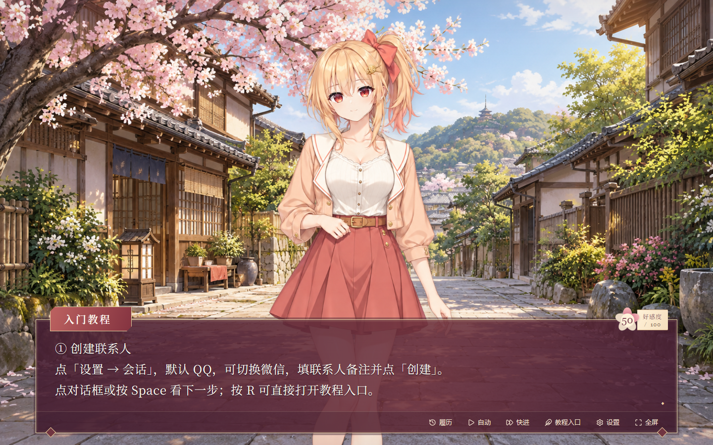

# GalChat

将任意微信/QQ私聊转化为实时的旮旯给木！！！

**作者：Shinochanwww** · Windows x64

[下载安装包](https://github.com/xiaomi0530/GalChat/releases/tag/v0.5.7) · [快速开始](docs/QUICKSTART.md) · [更新记录](CHANGELOG.md) · [反馈问题](https://github.com/xiaomi0530/GalChat/issues)

## 能做什么

- 在微信和 QQ 之间选择，一次连接一位好友的私聊！
- 将双方消息分别实时呈现为角色台词！
- 使用自己的 DeepSeek API Key 生成回复选项，并根据聊天内容驱动表情、动作和好感度！天呐，现实聊天真的有选项可以选？？
- 可以为自己的好友设置昵称、选择四位女性或四位男性角色作为ta的立绘；每位好友的角色、背景、关系和好感度分别保存！
- 根据聊天内容判断好友对自己的好感度升降！？

## 下载与使用

1. 在 [0.5.7 发布页](https://github.com/xiaomi0530/GalChat/releases/tag/v0.5.7) 下载 `GalChat-Setup-0.5.7-x64.exe`。
2. 退出旧版 GalChat / 花间信，运行安装程序。已有数据继续沿用。
3. 打开软件，按入门教程创建联系人、连接私聊；需要 AI 生成回复选项时再保存自己的 DeepSeek Key。

安装使用不需要 Node.js 或 Python。新用户默认 QQ、晴栀、慢速文字、显示好感度。完整步骤见[快速开始](docs/QUICKSTART.md)。

## 当前版本范围

**0.5.7 是第一版公开的 Windows 测试版。** 已通过 368 项核心测试和 97 项界面测试。本版不承诺所有版本、全部最小化状态或完整历史读取均可用，见[兼容性说明](docs/COMPATIBILITY.md)。

保存 DeepSeek Key 会自动开启云端分析及回复生成；可以在设置中关闭。聊天数据库保存在本机且未加密；启用 AI 后，会将当前会话的所选上下文发给 DeepSeek，见[隐私说明](docs/PRIVACY.md)。

## 仓库说明

此仓库仅提供软件介绍、使用说明、问题反馈和安装包下载。

GalChat 的运行代码与资源随安装包分发，软件版权说明见 [COPYRIGHT.md](COPYRIGHT.md)，第三方组件保留各自许可证和版权声明。

GalChat 与腾讯、微信、QQ、DeepSeek 无官方隶属关系。反馈问题时请隐藏聊天正文、联系人信息和 API Key。
