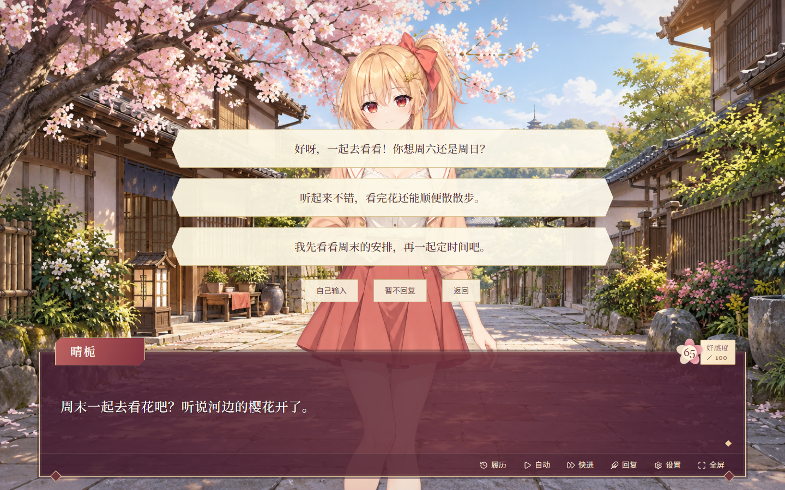
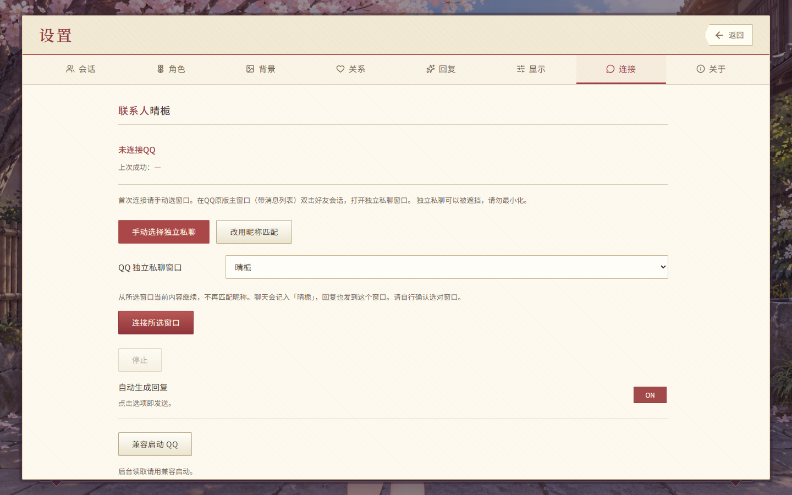
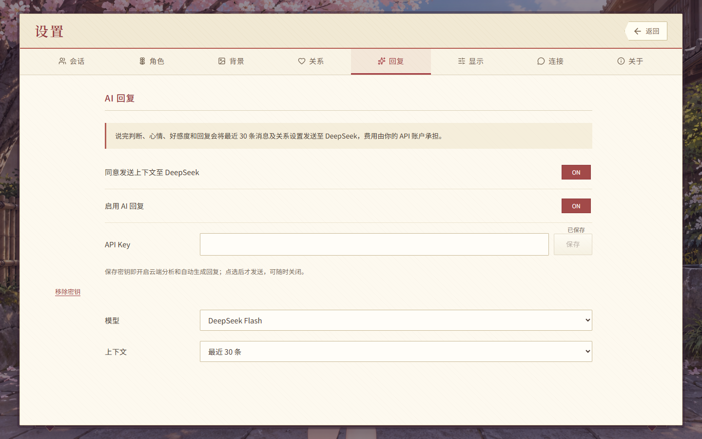

# GalChat

将 QQ 私聊转化为实时的旮旯给木！！！

**作者：Shinochanwww** · Windows x64 ·  **0.5.21**

[下载安装包](https://github.com/xiaomi0530/GalChat/releases/latest) · [图文使用指引](docs/QUICKSTART.md) · [更新记录](CHANGELOG.md) · [反馈问题](https://github.com/xiaomi0530/GalChat/issues)

**QQ：当前可用。微信：待开发，当前版本不提供微信连接、同步或发送功能。**

*以下均为 0.5.21 界面截图，使用虚构联系人和聊天示例。*

## 三步开始聊天

先在[发布页](https://github.com/xiaomi0530/GalChat/releases/latest)下载 `.exe` 安装包，退出旧版后安装。无需 Node.js 或 Python，升级保留已有数据。

### 1. 连接 QQ

- 在 **QQ 原版主窗口**双击好友会话，打开该好友的**独立私聊窗口**。
- GalChat **设置 → 会话**：输入好友备注，点击 **创建**。
- **设置 → 连接 → 手动选择独立私聊**，选中对应窗口，点击 **连接所选窗口**。

显示 **自动同步中** 即连接成功。QQ 独立私聊可以被遮挡，**请勿最小化**。

### 2. 生成回复

**设置 → 回复**：填入自己的 **DeepSeek API Key**，点击 **保存**。保存后自动开启 AI 与回复生成；收到新消息后，软件判断对方说完再生成选项。

AI 会使用当前会话的聊天上下文，费用由你的 DeepSeek API 账户承担。可以随时关闭。

### 3. 点选发送

回到主界面，点击 **回复** 查看选项，**点中哪条就发送哪条，无需再次确认**。

| 你想做什么 | 操作 |
| --- | --- |
| 发送生成的回复 | 点击对应选项 |
| 自己写一句 | **自己输入** → 输入文字 → **Enter** 发送 |
| 输入时换行 | **Ctrl + Enter** |
| 这轮不回复 | **暂不回复** |
| 查看聊天记录 | **H** 或 **履历** |

## 更多玩法

- 四位女性、四位男性角色可选；角色、背景、关系、好感度和草稿按好友分别保存。
- 表情、动作和游戏好感度随聊天变化，双方消息分别显示为台词。
- 六种关系各有完整的默认说话习惯，在 **设置 → 关系** 中编辑并保存。
- 内置中文字体；默认晴栀、慢速文字和好感度显示。

## 仓库说明

本仓库仅发布介绍、使用说明和安装包。GitHub 自动生成的 Source code 压缩包仅包含发布仓库文档，安装请下载 `.exe`。

版权见 [COPYRIGHT.md](COPYRIGHT.md)，第三方组件保留各自许可证。GalChat 与腾讯、QQ、微信、DeepSeek 无官方隶属关系。反馈时请隐藏聊天正文、联系人信息和 API Key。
